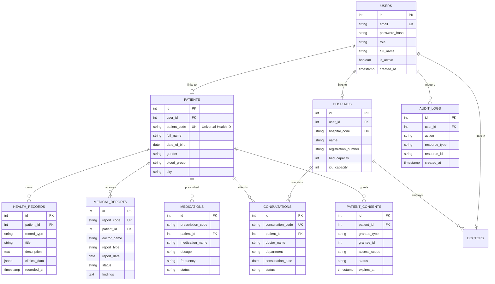

# MedIntelliX Database Design & Architecture

## Overview
The MedIntelliX database is designed around a patient-centric, interoperable healthcare model that solves healthcare data fragmentation through a **Universal Health ID (UHID)** and enforces fine-grained **Role-Based Access Control (RBAC)**.

---

## 1. Entity Relationship Diagram (ERD)

---

## 2. Universal Health ID (UHID) Standard
Every patient registered on MedIntelliX is assigned a standardized, verifiable identifier:
- **Format**: `MID-YYYY-XXXXXX` (e.g. `MID-2026-F89KL2`)
- **Prefix (`MID-`)**: MedIntelliX Identifier
- **Year (`YYYY`)**: Year of registration
- **Entropy (`XXXXXX`)**: Cryptographically random alphanumeric characters avoiding ambiguous glyphs (0/O, 1/I).
- **Interoperability**: Serves as the primary foreign key across all health facilities, consultations, lab networks, and claims.

---

## 3. Security, Privacy & Consent
- **Password Security**: Passwords salted and hashed with `bcryptjs` (work factor 10).
- **Session Tokens**: Cryptographically signed JSON Web Tokens (`HS256`) carrying user identity and role.
- **Dynamic Consent**: The `patient_consents` table empowers patients to grant, restrict, or revoke hospital/doctor access to their health timeline.
- **Audit Logging**: Every sensitive view, update, and data export is logged in `audit_logs` for regulatory compliance (HIPAA / DISHA).
