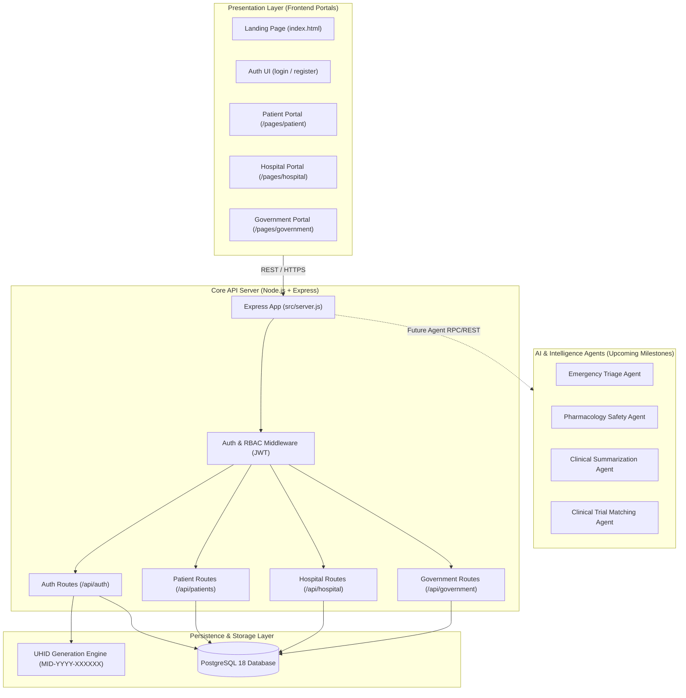

# MedIntelliX System Architecture

## Architecture Principles
1. **Separation of Concerns**: Presentation portals operate as clean decoupling clients consuming standard REST APIs.
2. **Universal Identification**: Healthcare record fragmentation is reconciled at ingestion by anchoring all clinical encounters to the patient's UHID.
3. **Defense in Depth**: Every API route enforces authentication and role-based permissions (`authenticate` & `authorize`).
4. **Extensibility for Clinical AI**: The data layer uses JSONB columns (`clinical_data`) designed to directly support future LLM embeddings, FHIR bundles, and agentic workflows.
